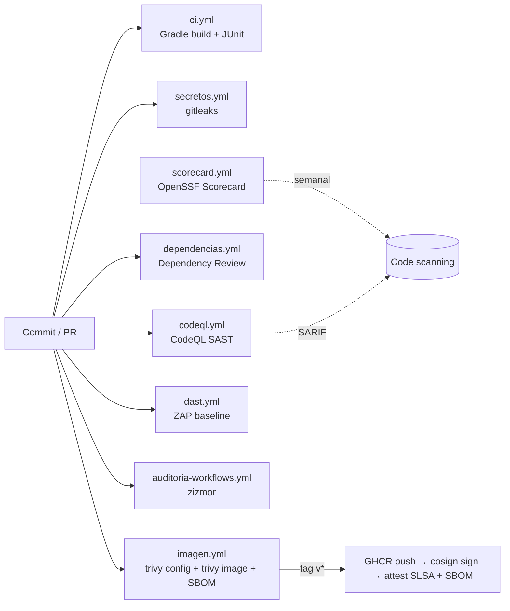

# springboot-ci — Pipeline DevSecOps de referencia

Aplicación Spring Boot mínima que se usa en **MCW-621 Ciberseguridad en la Nube** (PUCMM / UCJC) para mostrar
cómo se pasa de un pipeline de integración continua a un pipeline **DevSecOps** con gates de seguridad.

| Referencia | Qué contiene |
| --- | --- |
| tag `v0-baseline` (rama `master`) | El punto de partida: CI básico, imagen como root, dependencia vulnerable fijada, actions por tag. **Vulnerable a propósito.** |
| rama `devsecops-referencia`, tag `v1-devsecops` | La solución de referencia descrita en este README. |
| ramas `demo/*` | Un cambio inseguro por rama. Cada PR abierto contra `devsecops-referencia` queda **bloqueado** por un gate. |

## Versiones

- Java 21 (Temurin), Gradle 9.8.0 (wrapper con `distributionSha256Sum`), Spring Boot 4.1.1.
- Imagen base `eclipse-temurin:21-jre-alpine-3.24`, fijada por digest.
- Todas las GitHub Actions están fijadas por SHA completo, con la versión en un comentario.

## Pipeline



| Etapa | Workflow | Herramienta | Gate (qué bloquea) |
| --- | --- | --- | --- |
| Build y pruebas | `ci.yml` | Gradle + JUnit 5 | Pruebas en rojo |
| Secretos | `secretos.yml` | gitleaks 8.30.1 (binario verificado) | Cualquier secreto en los commits del PR; en push/schedule, en todo el historial |
| SAST | `codeql.yml` | CodeQL `security-extended` | Alertas con *security-severity* ≥ 7.0 |
| SCA | `dependencias.yml` | Dependency submission (Gradle) + Dependency Review | Dependencias nuevas con CVE de severidad alta o crítica |
| Contenedor | `imagen.yml` | Trivy 0.74.0 | Misconfiguración HIGH/CRITICAL del Dockerfile (p. ej. usuario root) o CVE HIGH/CRITICAL con parche disponible |
| SBOM | `imagen.yml` | Trivy (CycloneDX y SPDX) | — (artefacto `sbom`) |
| Publicación (solo tags) | `imagen.yml` | GHCR, cosign 3.1.3 keyless, `actions/attest` | Solo se firma lo que pasó el escaneo |
| DAST | `dast.yml` | ZAP 2.17.0 baseline | Cualquier alerta WARN/FAIL no justificada en `.zap/rules.tsv` |
| Pipeline | `auditoria-workflows.yml` | zizmor 1.30.1 | `pull_request_target` inseguro, inyección por `${{ }}`, actions sin fijar, permisos excesivos |
| Postura | `scorecard.yml` | OpenSSF Scorecard | — (informativo; SARIF en Code scanning) |

### Principios aplicados

- `permissions: {}` en cada workflow; cada job pide solo lo que usa. `id-token: write` existe únicamente en el job que publica en tags.
- Ningún valor `${{ github.event.* }}` se interpola en un `run:`; se pasa por `env:`.
- No se usa `pull_request_target`. `actions/checkout` siempre con `persist-credentials: false`.
- Las herramientas se instalan con versión exacta (y checksum cuando se descargan a mano).
- Dependabot (`.github/dependabot.yml`) actualiza Gradle, Docker y los SHA de las actions, con un *cooldown* de 14 días.
- `CODEOWNERS` cubre `.github/`, los archivos de build y los archivos de instrucciones para agentes de IA.
- Ruleset recomendado: [`docs/ruleset-recomendado.md`](docs/ruleset-recomendado.md).

## Cambios respecto a `v0-baseline`

| Antes | Después | Motivo |
| --- | --- | --- |
| Clave "AWS" en `SpringbootCiApplication.java` | Eliminada | Secretos fuera del código. Sigue en el historial (ver nota) |
| `jackson-databind` fijado a mano | Lo gestiona el BOM de Spring Boot; parches puntuales documentados en `build.gradle` | Las versiones fijadas a mano se quedan atrás |
| Spring Boot 3.5.3 | 4.1.1 | La rama 3.5 ya no recibe parches OSS |
| Imagen como root | `USER 10001` (UID numérico) | Kubernetes solo valida `runAsNonRoot` con UID numérico |
| Sin `HEALTHCHECK` | `HEALTHCHECK` contra `/actuator/health` | Orquestador y Compose detectan fallos |
| Base por tag | Base por digest | Reproducibilidad e integridad |
| `-Djava.security.egd=file:/dev/./urandom` | Eliminado | Innecesario en JDK modernos |
| Sin `.dockerignore` | `.dockerignore` excluye `.git`, `build`, `.gradle` | El historial no entra al contexto de build |
| Actions por tag (`@v3`, `@v4`) y SHA mezclados | Todas por SHA | Caso Trivy, marzo de 2026 |
| `COSIGN_EXPERIMENTAL`, cosign 2.2.3 | cosign 3.1.3 keyless | El modo keyless ya no es experimental |
| `SECURITY.md` plantilla | Política real con canal privado y plazos | |

**Nota sobre el secreto del historial.** gitleaks no detecta la cadena `AKIA1234567890EXAMPLEKEY` del commit `8097153`:
no cumple el formato real de una llave de AWS (`AKIA` + 16 caracteres `A-Z2-7`). Es un **falso negativo** de las
herramientas basadas en expresiones regulares y se discute en el laboratorio 3.

## Ramas de demostración

| Rama | Cambio inseguro | Gate que lo bloquea |
| --- | --- | --- |
| `demo/secreto` | API key ficticia en `application.properties` | `secretos.yml` (gitleaks) |
| `demo/dependencia-vulnerable` | `jackson-databind:2.12.7.1` (la versión del baseline; tiene avisos HIGH vigentes, p. ej. GHSA-wv8q-qhhj-9h54) | `dependencias.yml` (Dependency Review) e `imagen.yml` (Trivy) |
| `demo/imagen-root` | Se elimina `USER` del Dockerfile | `imagen.yml` (`trivy config`, DS002) |
| `demo/pwn-request` | Workflow con `pull_request_target`, checkout del PR e interpolación del título | `auditoria-workflows.yml` (zizmor) |

## Verificar la imagen publicada

Cada tag `v*` publica `ghcr.io/vacax/springboot-ci:<tag>`, firmada sin llaves (keyless) por la identidad OIDC del workflow.

```bash
cosign verify ghcr.io/vacax/springboot-ci:v1-devsecops \
  --certificate-identity https://github.com/vacax/springboot-ci/.github/workflows/imagen.yml@refs/tags/v1-devsecops \
  --certificate-oidc-issuer https://token.actions.githubusercontent.com

gh attestation verify oci://ghcr.io/vacax/springboot-ci:v1-devsecops -R vacax/springboot-ci
```

## Ejecutar localmente

```bash
./gradlew test
docker build -t springboot-ci .
docker run --rm -p 8080:8080 springboot-ci
```
